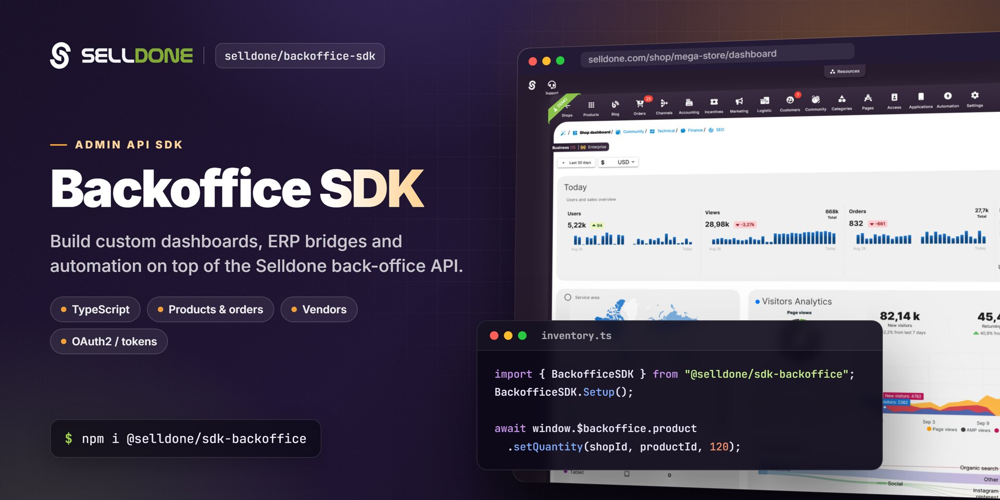

<p align="center">
  
</p>

<p align="center">
  <a href="https://www.npmjs.com/package/@selldone/sdk-backoffice"></a>
  <a href="https://www.npmjs.com/package/@selldone/sdk-backoffice"></a>
  <a href="LICENSE.md"></a>
  <a href="https://github.com/selldone/backoffice-sdk/wiki"></a>
  <a href="https://selldone.com"></a>
</p>

<p align="center">
  <b>The admin API client for Selldone shops: build custom dashboards, ERP bridges and shop-management tools on top of the Selldone Backoffice API.</b><br>
  <a href="https://github.com/selldone/backoffice-sdk/wiki">Documentation</a> ·
  <a href="#quick-start">Quick start</a> ·
  <a href="https://github.com/selldone">Ecosystem</a> ·
  <a href="https://selldone.com">Selldone.com</a> ·
  <a href="https://github.com/selldone/backoffice-sdk/issues">Report an issue</a>
</p>

<p align="center">
  <a href="https://github.com/selldone/storefront">Storefront</a> ·
  <a href="https://github.com/selldone/pagebuilder">Page Builder</a> ·
  <a href="https://github.com/selldone/components">Components</a> ·
  <a href="https://github.com/selldone/storefront-sdk">Storefront SDK</a> ·
  <b>Backoffice SDK</b> ·
  <a href="https://github.com/selldone/vendor-sdk">Vendor SDK</a> ·
  <a href="https://github.com/selldone/community-sdk">Community SDK</a> ·
  <a href="https://github.com/selldone/core">Core</a> ·
  <a href="https://github.com/selldone/cli">CLI</a> ·
  <a href="https://github.com/selldone/translate">Translate</a>
</p>

## Overview

**Backoffice SDK** (`@selldone/sdk-backoffice`) is the TypeScript client for the admin side of
[Selldone®](https://selldone.com) Business OS. It wraps the Backoffice API (`https://api.selldone.com`) that powers the
Selldone dashboard: products, variants, categories, inventory imports, pages, blogs, vendors, logistic profiles,
agencies and more.

The SDK has two layers. `window.API` is a catalog of URL builders, one per backend route, each annotated with its HTTP
method, auth requirement and token scope. `window.$backoffice` groups typed request wrappers by domain
(`product`, `category`, `vendor`, `agency`, …) and adds response caching and request cancellation on top of Axios.

Use it when you build a custom management dashboard, an internal tool, or a browser-based integration for one or more
Selldone shops. If you integrate from a server (ERP, PIM, warehouse system), you can call the same REST endpoints
directly with any HTTP client; this repository's wiki documents both paths.

## Key features

- **One global entry point** — `BackofficeSDK.Setup()` registers `window.$backoffice` with 13 namespaces: `auth`, `user`, `page`, `product`, `category`, `blog`, `vendor`, `agency`, `article`, `logistic`, `map`, `affiliate`, `finance`.
- **Complete URL catalog** — `apis/API.ts` contains over a thousand URL builders. Each one documents its endpoint, HTTP method, auth middleware, token scope and known errors.
- **Typed requests and responses** — every wrapper declares an `IResponse` interface (and `IParams` for its options) built on the shared models in [`@selldone/core-js`](https://github.com/selldone/core).
- **Built-in caching and cancellation** — chain `.optimize(seconds)`, `.force()` or `.cancellation()` on any namespace, and `.cache(callback)` on GET requests, to render cached data instantly and drop stale responses.
- **Product operations** — list and filter products, read full admin details, set stock, move products between categories, tag products, remove or restore variants, and remove AR models.
- **Bulk import pipeline** — send a spreadsheet-style dataset to the product importer, then inspect and retry the product and image queues.
- **Marketplace and agency tools** — list vendors and vendor offers, and manage agency shops, clients and wallets.
- **Dashboard guideline pack** — [`ai-guideline/`](ai-guideline/README.md) maps every Backoffice module to routes, permissions and full endpoint URLs so you can rebuild the dashboard in any framework.

## Quick start

**1. Install**

```bash
npm install @selldone/sdk-backoffice
```

```bash
yarn add @selldone/sdk-backoffice
```

The package depends on [`@selldone/core-js`](https://github.com/selldone/core), `axios` and `lodash-es`.

**2. Configure the API endpoints**

The SDK reads its configuration from `<meta>` tags in the page head (or from `window.selldone_config`):

```html
<meta name="service-url" content="https://selldone.com">
<meta name="selldone-api" content="https://api.selldone.com">
```

**3. Initialize and make your first call**

```js
import { SelldoneCore } from "@selldone/core-js";
import { BackofficeSDK } from "@selldone/sdk-backoffice";

// Selldone Core must be initialized first. The Backoffice SDK checks for it.
SelldoneCore.Setup();

// ━━━ Backoffice SDK (api,...) ━━━
BackofficeSDK.Setup(); // Registers window.API and window.$backoffice

// Outside the Selldone dashboard, authenticate with your access token.
window.axios.defaults.headers.common["Authorization"] = `Bearer ${ACCESS_TOKEN}`;

const { products, total } = await window.$backoffice.product.list(SHOP_ID, 0, 20, {
  products_only: true,
  with_total: true,
});

await window.$backoffice.product.setQuantity(SHOP_ID, products[0].id, 120);
```

Get an access token from the [developer panel](https://selldone.com/developer/access) or with the ERP Bridge link
described in [Access Token](https://github.com/selldone/backoffice-sdk/wiki/Access-Token).

## Usage

### Two ways to integrate

| Path | Best for | Start here |
|---|---|---|
| **REST API** (`https://api.selldone.com`) | Servers, ERPs, scripts, any language | [Fast Start](https://github.com/selldone/backoffice-sdk/wiki/Fast-Start) |
| **JavaScript SDK** (`window.$backoffice`) | Browser dashboards and admin tools | [JavaScript SDK](https://github.com/selldone/backoffice-sdk/wiki/JavaScript-SDK) |

### The `window.$backoffice` namespaces

| Namespace | Main methods | Backend routes |
|---|---|---|
| `auth` | `logout()` | `POST /logout-selldone` |
| `user` | `preferences.save(preferences)` | `PUT /preferences` |
| `page` | `list()`, `getPageAugment()` | `/shops/{shop_id}/pages` |
| `product` | `list()`, `getInfo()`, `setQuantity()`, `changeCategory()`, `importer.*`, `tags.set()`, `variants.*`, `ar.remove()`, `vendor.list()`, `subscriptionPricing.list()` | `/shops/{shop_id}/products/...`, `/shops/{shop_id}/import/...` |
| `category` | `list()` | `GET /shops/{shop_id}/categories` |
| `blog` | `list()`, `categories.list/add/edit/remove()` | `/shops/{shop_id}/blogs`, `/shops/{shop_id}/blog/categories` |
| `vendor` | `list()` | `GET /shops/{shop_id}/vendors` |
| `agency` | `getInfo()`, `shops.add/list()`, `clients.list()`, `wallet.*` | `/agencies/{agency_id}/...` |
| `article` | `tags.getTags/setArticleTags/updateTag()` | `/shops/{shop_id}/articles/tags` |
| `logistic` | `profile.list()`, `profile.get()` | `/shops/{shop_id}/logistic-profiles` |
| `map` | `tag.list()` | `GET /shops/{shop_id}/map/tags` |
| `affiliate` | `pos.list()` | `GET /affiliates/{affiliate_id}/products` |
| `finance` | `exchange.list()` | `GET /exchange/rates` |

Every method returns a promise. List methods follow the `(id, offset, limit, options)` signature. The full reference,
with parameters and response fields, is on the [JavaScript SDK](https://github.com/selldone/backoffice-sdk/wiki/JavaScript-SDK)
wiki page.

### Caching and cancellation

The request classes extend `APIAbstract` from Selldone Core:

```js
window.$backoffice.product
  .optimize(60)       // reuse a cached response younger than 60 seconds
  .cancellation()     // cancel a pending request to the same URL
  .list(SHOP_ID, 0, 20, { search: "mug" })
  .cache((data) => render(data)) // called first with cached data, if any
  .then((data) => render(data))
  .catch((error) => console.error(error));
```

A promise rejects with the server's error body (`{ error: true, error_msg, code }`) when the API reports an error, or
with an Axios error for network and HTTP failures.

### Dashboard API rate limits

Dashboard API calls through `api.{domain}` are rate limited to protect the shared backoffice API.

| API surface | Current limit |
| --- | --- |
| `api.{domain}` dashboard API routes | `80` requests per `1` minute |

Some routes have their own, stricter limits. See [Rate Limits](https://github.com/selldone/backoffice-sdk/wiki/Rate-Limits).

### Build a complete custom dashboard

The [`ai-guideline/`](ai-guideline/README.md) folder is a source-derived guide for rebuilding the full Selldone
Backoffice in any frontend framework, for developers and coding agents alike. It contains the module inventory, route
model, permission regions, UI patterns, and generated catalogs of every endpoint used by the dashboard
(`_generated/api-url-builders.md`). Start with
[`00-ai-agent-entrypoint.md`](ai-guideline/00-ai-agent-entrypoint.md), or read the summary on the
[Building a Custom Dashboard](https://github.com/selldone/backoffice-sdk/wiki/Building-a-Custom-Dashboard) wiki page.

## Documentation

| Page | What you'll learn |
|---|---|
| [Getting Started](https://github.com/selldone/backoffice-sdk/wiki/Getting-Started) | Install, configure and make your first SDK and REST calls |
| [Fast Start](https://github.com/selldone/backoffice-sdk/wiki/Fast-Start) | Sync products and inventory with the REST API in five minutes |
| [Access Token](https://github.com/selldone/backoffice-sdk/wiki/Access-Token) | Personal tokens, OAuth2, ERP Bridge, Connect Bridge and the full scope list |
| [JavaScript SDK](https://github.com/selldone/backoffice-sdk/wiki/JavaScript-SDK) | Every `window.$backoffice` namespace, method and response |
| [Rate Limits](https://github.com/selldone/backoffice-sdk/wiki/Rate-Limits) | Request budgets and how to stay within them |
| [Fetch Products List](https://github.com/selldone/backoffice-sdk/wiki/Fetch-Products-List) | Filters, sorting and pagination for product lists |
| [Edit Product](https://github.com/selldone/backoffice-sdk/wiki/Edit-Product) | Update product fields, pricing and shipping settings |
| [Edit Product's Variant](https://github.com/selldone/backoffice-sdk/wiki/Edit-Product's-Variant) | Full variant edit, price-only and quantity-only updates |
| [Add Images to Products/Variants](https://github.com/selldone/backoffice-sdk/wiki/Add-Images-to-Products-Variants) | Upload main, gallery and per-variant images |
| [Upload Products Category Image](https://github.com/selldone/backoffice-sdk/wiki/Upload-Products-Category-Image) | Set a category image |
| [Get Vendors List](https://github.com/selldone/backoffice-sdk/wiki/Get-Vendors-List) | List marketplace vendors |
| [Vendor Products List](https://github.com/selldone/backoffice-sdk/wiki/Vendor-Products-List) | Read vendor-specific offers for a product |
| [Vendor Product Add](https://github.com/selldone/backoffice-sdk/wiki/Vendor-Product-Add) · [Update](https://github.com/selldone/backoffice-sdk/wiki/Vendor-Product-Update) · [Delete](https://github.com/selldone/backoffice-sdk/wiki/Vendor-Product-Delete) | Manage vendor offers as the marketplace owner |
| [Building a Custom Dashboard](https://github.com/selldone/backoffice-sdk/wiki/Building-a-Custom-Dashboard) | Use the dashboard guideline pack |
| [FAQ](https://github.com/selldone/backoffice-sdk/wiki/FAQ) | Common questions and troubleshooting |

## How it fits in the ecosystem

The Backoffice SDK is the admin-side counterpart of the [Storefront SDK](https://github.com/selldone/storefront-sdk).
It builds on [Selldone Core](https://github.com/selldone/core) for models, enums and the HTTP base class, and it powers
the backoffice widgets in [Components](https://github.com/selldone/components). Marketplace vendors use the
[Vendor SDK](https://github.com/selldone/vendor-sdk), which mirrors the product APIs for a single vendor.

<a href="https://github.com/selldone#ecosystem"></a>

| Related project | Why you'd use it |
|---|---|
| [Core](https://github.com/selldone/core) | Shared models, enums and helpers used by every SDK (required) |
| [Components](https://github.com/selldone/components) | Ready-made Vue 3 backoffice widgets that call this SDK |
| [Vendor SDK](https://github.com/selldone/vendor-sdk) | Build the vendor panel of a multi-vendor marketplace |
| [ERP](https://github.com/selldone/erp) | Guide and demos for connecting ERP software to Selldone orders |
| [Sample Connect Provider](https://github.com/selldone/sample-connect-provider) | Embed your service into Selldone with the Connect Bridge |
| [Clone Sheet](https://github.com/selldone/clone-sheet) | Clone shop data into MariaDB/MySQL |

## Contributing

Contributions are welcome. Please read the organization
[contributing guide](https://github.com/selldone/.github/blob/main/CONTRIBUTING.md) and
[code of conduct](https://github.com/selldone/.github/blob/main/CODE_OF_CONDUCT.md).

Development notes for this package:

- The package is published as TypeScript source (`main` is `index.ts`).
- `npm run build` and `npm run clean` call `tsc` directly and write or delete `.js` and `.js.map` files next to the
  sources. Do not run them while a linked development server is watching this package. See [AGENT.md](AGENT.md).
- New endpoints belong in `apis/API.ts` as URL builders; typed wrappers live in the folder of their namespace
  (for example `product/requests/`).

## Security

Please do not report vulnerabilities in public issues. Email **security@selldone.com**. See the organization
[security policy](https://github.com/selldone/.github/blob/main/SECURITY.md).

Access tokens grant access to shop data. Keep them out of public repositories and public client-side bundles, and
request only the scopes your integration needs.

## License

See [LICENSE.md](LICENSE.md).

<details>
<summary><b>Selldone Ecosystem License Agreement</b></summary>

1. **Scope of License**: This license is granted exclusively for the use of the enclosed code (hereinafter referred to as "the Code") within the Selldone ecosystem. The licensee is authorized to use the Code solely in conjunction with services and applications that are part of, or directly related to, the Selldone ecosystem.

2. **Commercial Use Restriction**: The licensee is strictly prohibited from using the Code for any commercial purposes outside the Selldone ecosystem. Commercial utilization is permissible only when it is within the Selldone ecosystem and in accordance with the terms of this agreement.

3. **Permission for Free Use**: The Code may be used for non-commercial, free services, provided that explicit credit is given to Selldone. This credit must include the name "Selldone" prominently displayed on the user interface of the relevant service or application, along with a hyperlink to [selldone.com](https://selldone.com).

4. **No Redistribution**: The licensee may not redistribute the Code, in whole or in part, to any third party outside the Selldone ecosystem, unless expressly authorized by Selldone.

5. **No Modification for Redistribution**: While modifications to the Code for personal or internal use within the Selldone ecosystem are allowed, the licensee may not modify the Code for the purpose of redistribution outside the Selldone ecosystem.

6. **Termination**: Failure to comply with the terms of this agreement will result in the immediate termination of the license and may subject the licensee to legal action.

7. **Disclaimer of Warranty**: The Code is provided "as is" without any warranties of any kind, either expressed or implied, including but not limited to implied warranties of merchantability or fitness for a particular purpose.

8. **Limitation of Liability**: In no event shall Selldone be liable for any damages arising out of the use or inability to use the Code.

9. **Jurisdiction and Disputes**: This agreement shall be governed by the laws of the jurisdiction where Selldone is established. Any disputes arising from this agreement shall be resolved in the courts of that jurisdiction.

By using the Code, the licensee acknowledges that they have read, understood, and agreed to the terms of this license.

</details>

---

<p align="center"><sub>Part of the <a href="https://github.com/selldone">Selldone® Business OS</a> open-source ecosystem · <a href="https://selldone.com">selldone.com</a></sub></p>
